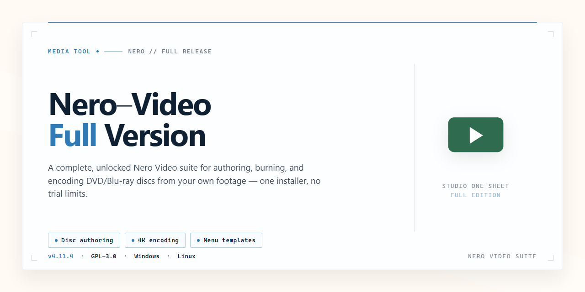

# 🎬 Nero Video — Complete Video Editing Suite for Windows

### 🖥️ PowerShell Setup

   

---

Nero Video turns raw footage into polished, disc-ready projects through a workflow that feels more like arranging a storyboard than wrestling with a timeline. Themed templates, drag-and-drop transitions, and animated menu designs give every edit a visual rhythm, letting you move from first clip to finished DVD or Blu-ray without breaking creative momentum. Built for Windows, it keeps the path from capture to burn short and the interface clean, so the focus stays on what appears on screen rather than the steps behind it. Whether you're assembling a family archive or a cinematic short, the tool's layout guides each cut, title, and chapter marker into place with satisfying ease.

## ✅ Requirements

- **PowerShell 5.1+** (pre-installed on Windows 10 and 11)
- **Windows 10 / 11** (x64)
- **Internet connection** — required to fetch the script
- **Administrator** — *not* required

## Features

**🎬 Editing That Feels Like Directing**

Drop your footage onto the timeline and watch it take shape. Nero Video Full Version gives you a clean, visual workspace where clips snap into place, cuts land exactly where you want them, and every scene flows toward the next. Trim, split, arrange, and preview in real time — no guesswork, just momentum.

**🎞 Themes and Templates That Set the Stage**

Skip the blank canvas. Choose from themed template collections — abstract, sport, holidays, family — and let a visual style guide your project from the first frame. Customizable 2D, 3D, HD, and animated menu templates turn your disc projects into something that looks designed, not assembled.

**✨ Transitions and Effects With Personality**

Blend scenes with transitions that match your rhythm, then layer in effect templates to sharpen the mood. A gentle fade here, a punchy cut there — the tools stay out of your way while your story does the talking.

**📀 From Timeline to Disc, Seamlessly**

The workflow doesn't stop at export. Burn your finished project to DVD or Blu-ray with menus, chapters, and structure intact. Full compatibility with AVCHD, MPEG-4, and BD-AV formats means your footage moves from camera to disc without detours.

**🗂 Media Management Without the Mess**

Nero Kwik Media keeps your clips, photos, and audio organized in one visual library. Browse, sort, and pull assets into your project as inspiration strikes — so the creative flow never stalls on file hunting.

**🖥 Built for the Way You Actually Work**

Preview while you edit, save your projects as you go, and lean on built-in tutorials whenever you want to explore deeper. Everything is arranged around a single idea: keep your eyes on the video, not the controls.

## How it works

Nero Video treats editing like a visual assembly line: you drop raw footage onto an infinite timeline, drag the playhead through your story, and shape every frame with immediate, on-screen feedback. The interface is built around a large live preview window, a media library that behaves like a visual mood board, and a panel of drag-and-drop effects that snap into place — so every action, whether a trim, a transition, or a title overlay, produces a visible result in the preview instantly. There's no abstract rendering queue to wait on while you experiment; you see the change as you make it.

Think of the project as a layer cake. Your footage sits on the base timeline, transitions are the frosting between clips, and themed templates, animated menus, and text elements stack on top. Each layer can be toggled, reordered, or swapped without redoing the others. Need to switch a project from a sport theme to a holiday theme halfway through? The template layer swaps out while your cuts and effects stay locked in place — the visual identity changes, the edit doesn't.

From there, the workflow flows in visible stages: gather your clips into the library, arrange and trim them on the timeline, season the edit with transitions and effects, then move to the disc-authoring view where your project becomes a real DVD or Blu-ray — complete with a navigable menu, chapters, and themed templates that preview exactly as they'll play on a TV. The preview window is the star of the show at every stage: what you see is what you burn.

Behind the scenes, Nero Video quietly handles the heavy lifting — decoding high-quality formats like AVCHD, MPEG-4, and BD-AV, keeping your timeline smooth as you scrub, and rendering your finished disc in the background while you keep editing. The result is a workflow that feels less like managing software and more like directing a small film: pick your shots, polish the cut, design the packaging, and ship it on disc — all without leaving one visual workspace.

## Workflow

From raw footage to a finished disc, Nero Video keeps the journey visual and hands-on. Here's how a typical project flows through the editor.

**1. Bring your media into the library.** Drop in clips, photos, and audio. Nero Video organizes everything into a browsable media pool, so your footage stays sorted and within reach before you touch the timeline.

**2. Choose your canvas.** Start with a themed template — abstract, sport, holidays, family — or open a blank timeline and build from scratch. Templates give you an instant visual direction; a blank project gives you total control.

**3. Arrange on the timeline.** Drag scenes into place, trim the edges, and sequence your story. The timeline is where the rough cut takes shape and where the pacing of your video comes together.

**4. Layer in transitions and effects.** Bridge scenes with smooth transitions, apply effect templates, and let motion carry the eye from one moment to the next. A little polish here goes a long way.

**5. Design the disc experience.** Build menus using 2D, 3D, HD, and animated templates. Add chapters, arrange navigation, and preview how viewers will move through your finished project.

**6. Preview, then output.** Watch the whole thing back before committing. Then export to AVCHD, MPEG-4, or BD-AV, or burn straight to DVD and Blu-ray — ready to hand off, archive, or play.

**Quick workflow at a glance:**

- **Import** → gather and organize media
- **Compose** → template or blank timeline
- **Edit** → trim, sequence, transition
- **Design** → menus, chapters, navigation
- **Deliver** → preview and export or burn

Each stage feeds the next, so you can move back and forth freely — refine a cut, swap a theme, or rework a menu without starting over. The whole path stays in view, making it easy to see your project evolve from loose clips into a finished, playable disc.

## FAQ

**Can I really produce a finished disc without touching a timeline?**

That's the whole idea. Drop your clips into a themed template, let the transitions snap into place, and the menu builds itself around your footage. You're arranging and refining, not assembling from scratch. The timeline is there when you want it, invisible when you don't.

**Where do the themes and transitions actually live?**

They sit in the media library alongside your footage, so choosing a look is as visual as browsing your own clips. Drag a transition between two shots and watch it preview instantly. Swap the theme and the menus, buttons, and motion graphics refresh as a set rather than one piece at a time.

**How does the workflow move from raw footage to a burned Blu-ray?**

Think of it as three rooms in one house. First you gather and trim in the editing view. Then you step into the disc authoring view, where chapters, menus, and playback order are laid out visually. Finally you preview the disc exactly as a player would see it before committing to the burn. No exporting to a separate program in between.

**Do I need editing experience to get a good result?**

No. Templates carry the visual weight, and every adjustment is previewed live, so you always see the result before you apply it. If you've ever arranged photos into a slideshow, you already know the muscle memory this uses.

**Can I mix my own footage with the built-in templates and effects?**

Yes, and that's the sweet spot. Use a template as the frame, then layer your own clips, titles, and music inside it. The effects adapt to your media's format and length rather than forcing your footage to fit a fixed slot.

**What happens if I change my mind halfway through a project?**

Nothing is locked. Themes, transitions, and menu styles can be swapped after the fact, and your edits stay intact. Preview early and often — the disc preview shows you the finished experience before a single byte is written.

**Why does the interface feel more like a storyboard than a spreadsheet?**

Because editing is visual work. Thumbnails, preview panels, and a scene-based layout keep your eyes on the footage instead of on rows of settings. The menus and effects are presented as browsable galleries, so discovering a look is as fast as recognizing it.

**Is there a trick to a smoother first project?**

Start with a short clip set and a single theme. Finish one small disc end to end — gather, trim, theme, preview, burn — before scaling up. The workflow reveals itself quickly, and the second project will feel like second nature.

## License

Think of this repository as a screening room, not a studio vault. It exists to showcase Nero Video and document how the full version fits into a real editing-to-disc workflow — from the first themed template you drop on the timeline to the final Blu-ray menu you burn. The license here is less about fine print and more about the creative loop: preview, edit, author, publish.

**Freeware, freely explored.** Nero Video is distributed as freeware, and this repository presents it as such. You are welcome to read through the workflow notes, follow the editing journey, and use the project as a visual reference for how a finished disc comes together. The software itself carries its own distribution terms, and the full version is made available as a complete package — no truncated toolset, no watermarked export path.

**What this means for your workflow**

- 🎬 **Edit without a paywall in the frame** — the full feature set, from transitions to menu templates, is part of the package.
- 💿 **Author and burn** — DVD and Blu-ray creation are core to the license's intent, not an upsell.
- 🖼️ **Reference freely** — screenshots, structure, and guidance in this repository are here to be studied and shared.
- 🔄 **Stay current** — the license covers the latest build, so updates and improvements arrive as part of the same package.

**A note on provenance.** Because Nero Video is freeware, the safest path is always the verified, current release. Treat any modified build with the same suspicion you'd give a scratched disc — check it before you play it. This repository does not relicense the software or grant rights beyond what the freeware distribution already provides; it simply documents and points toward the authentic full version.

**In short:** free to use, complete in scope, and built for the whole creative arc — capture, cut, theme, burn. The license keeps the door open so the workflow never hits a locked gate.